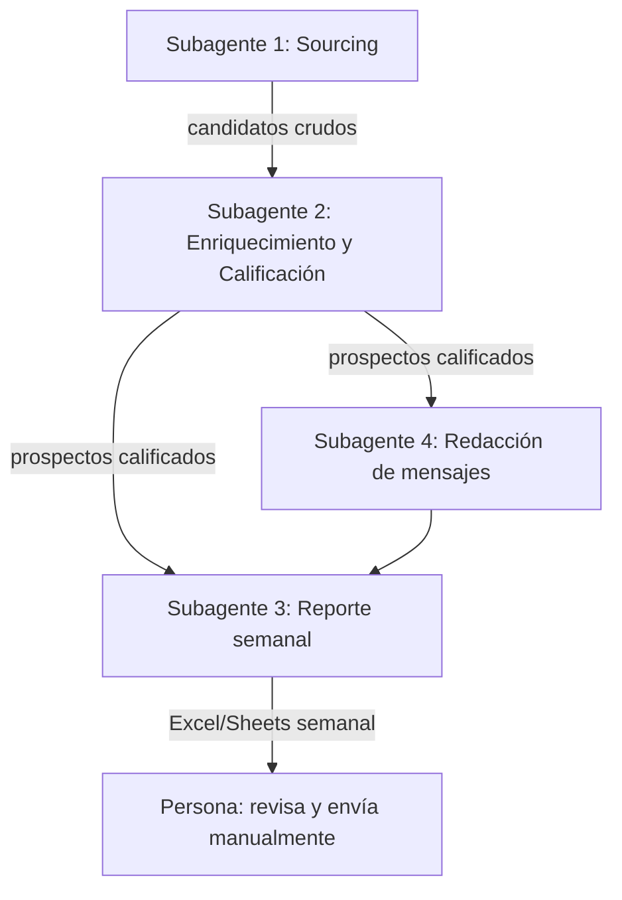

# Prospección TurboEmpresa

Agente multi-etapa construido en [OpenCode](https://opencode.ai) para
encontrar, calificar y preparar mensajes personalizados para prospectos de
alto perfil (capacidad de inversión ~$21,000 USD) para
[TurboEmpresa](https://turboempresa.com/). **No envía mensajes de forma
automática** — solo entrega un reporte semanal con contactos calificados y un
borrador de mensaje por cada uno, para que el envío lo haga una persona.

## Por qué no se automatiza la búsqueda dentro de LinkedIn/Facebook/Instagram

LinkedIn, Facebook e Instagram detectan cuentas automatizadas por **patrones
de comportamiento** (volumen de visitas a perfiles, velocidad de navegación,
fingerprint del navegador) — no solo por enviar mensajes. Un bot que solo
"mira" perfiles puede terminar baneando la cuenta igual que uno que envía
spam. Por eso este proyecto obtiene datos de perfiles públicos **indexados
por Google** (`site:linkedin.com/in ...`), nunca iniciando sesión ni
automatizando un navegador contra esas plataformas.

## Arquitectura



| Subagente | Estado | Función |
|---|---|---|
| 1. Sourcing | ✅ Construido en este commit | Busca candidatos vía Google Custom Search, restringido a `linkedin.com/in`, y deduplica contra semanas anteriores |
| 2. Enriquecimiento/Calificación | ⏳ Pendiente | Investiga cada candidato y aplica la rúbrica de `docs/criterios-calificacion.md` |
| 3. Reporte semanal | ⏳ Pendiente | Genera el Excel/Sheets con los prospectos calificados |
| 4. Redacción de mensajes | ⏳ Pendiente | Redacta un mensaje personalizado por prospecto calificado |

Ver `docs/criterios-calificacion.md` para el ICP, la rúbrica de calificación y
los números de alcance semanal.

## Requisitos

- OpenCode instalado (Desktop o CLI)
- Node.js (para el custom tool y el script de búsqueda)
- Una API key de [Serper.dev](https://serper.dev)

## Paso 1 — Crear tu cuenta y API key en Serper.dev

Ve a [serper.dev](https://serper.dev) y regístrate (incluye 2,500 consultas gratis de prueba, sin tarjeta de crédito). Una vez dentro, copia tu API key desde el dashboard.

> Nota histórica: la primera versión de este proyecto usaba la API de Google Custom Search directamente. Esa API está cerrada a clientes nuevos desde 2026 (se apaga por completo el 1 de enero de 2027), así que se reemplazó por Serper.dev, que regresa los mismos resultados reales de Google.

## Paso 2 — Configurar variables de entorno

```bash
cp .env.example .env
```

Edita `.env` y llena `SERPER_API_KEY` con el valor del paso 1.

## Paso 3 — Instalar dependencias del tool

```bash
cd .opencode/tool
npm init -y
```

```bash
npm install node-fetch dotenv
```

## Paso 4 — Correr el subagente de Sourcing

Desde la raíz del proyecto, en OpenCode:

```bash
opencode run --agent sourcing "Busca candidatos para esta semana"
```

El resultado (candidatos crudos en JSON) se guarda en `data/candidatos-semana-N.json`.

## Estructura del proyecto

```
README.md                          → este archivo
docs/criterios-calificacion.md     → ICP, rúbrica de calificación, alcance semanal
config/icp.json                    → puestos, industrias y regiones objetivo (editable sin tocar código)
.opencode/agent/sourcing.md        → definición del Subagente 1
.opencode/tool/linkedin_search.ts  → herramienta que consulta Google Custom Search
data/                               → candidatos recolectados por semana (no se sube a git)
```
